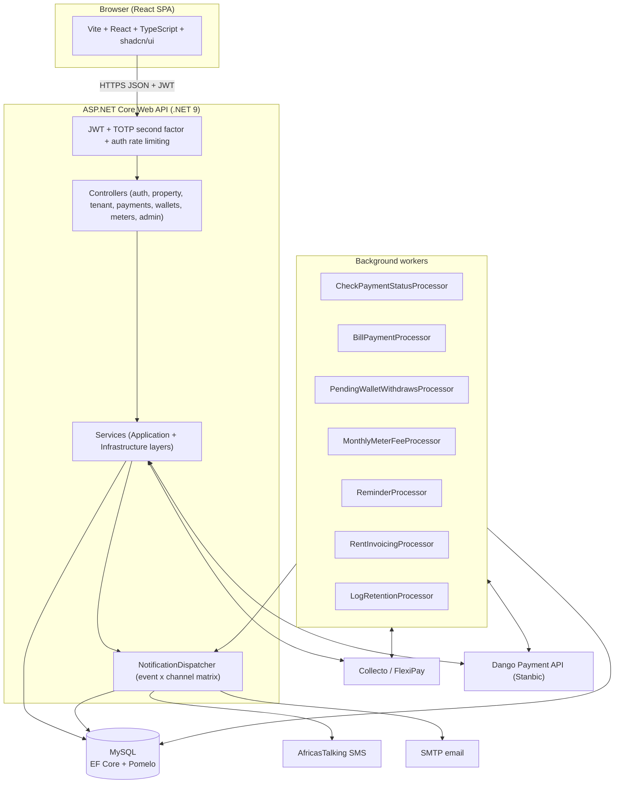
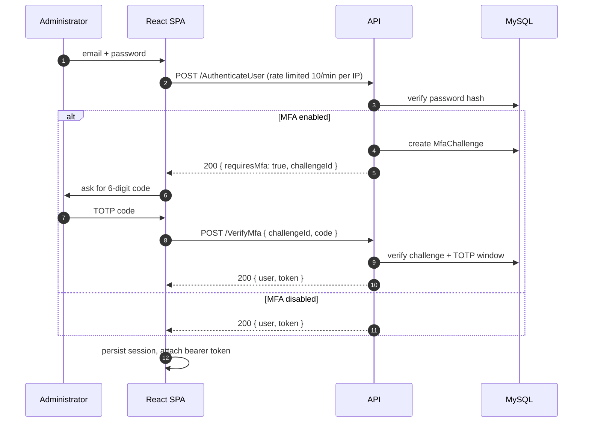
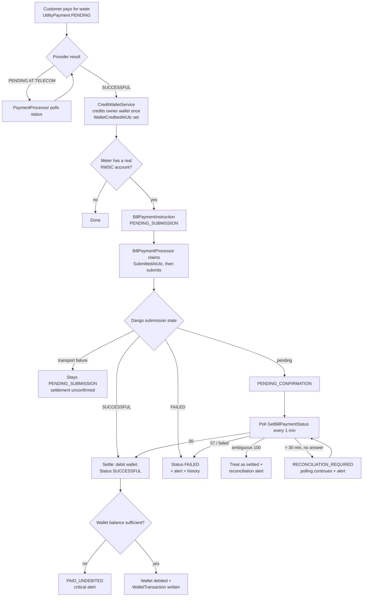
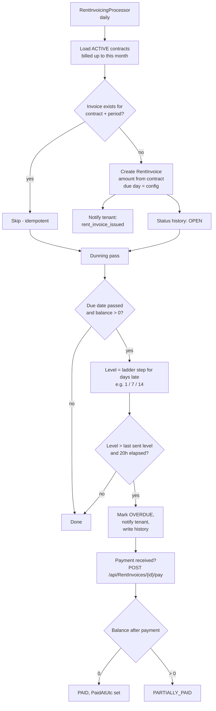
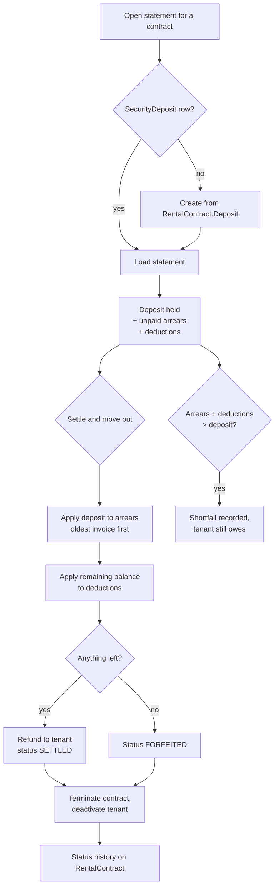
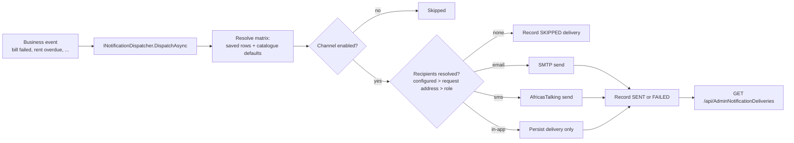
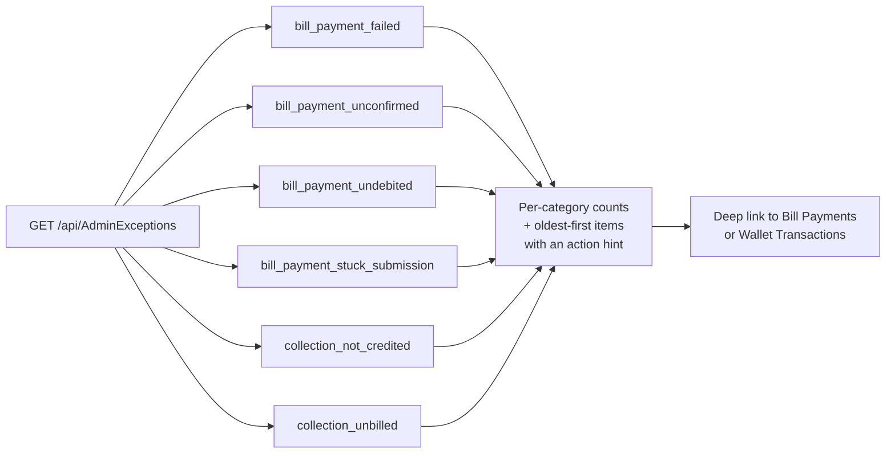

# Rental Management System (Nyumba Yo / DangoPay)

A full-stack property and rent management platform for landlords, tenants, and utility operators, with integrated mobile-money and bank payments, wallet payouts, NWSC water-bill payments, SMS notifications, and administrator tooling.

- **Frontend:** React + Vite + TypeScript + shadcn/ui (see `Frontend/`)
- **Backend:** ASP.NET Core Web API on .NET 9 (see `Backend/PropertyManagementApi/`)
- **Database:** MySQL via EF Core + Pomelo (migrations auto-apply on startup)
- **Payments:** Collecto (FlexiPay) and Dango Payment API (Stanbic), with a provider router and background status workers

---

## 1. Architecture



- The frontend is a single-page app that talks to the API with a JWT bearer token (attached automatically by the shared `axios` client in `src/lib/api.ts`).
- The API follows a layered structure: `API` (controllers) → `Application` (interfaces) → `Infrastructure` (services, EF Core, payment adapters) → `Domain` (entities + DTOs).
- Financial operations are idempotent: references are durably claimed before any network call, and background workers reconcile settlement by polling the provider rather than trusting submission responses.
- All money is stored as `decimal(18,2)` and rounded through one helper (`Domain/Money.cs`), so charging, settling and refunding cannot disagree by a cent.
- Every notification — bill failures, unconfirmed payments, rent reminders — goes through one dispatcher that reads an administrator-editable event × channel matrix and records each attempt in `NotificationDeliveries`.

## 2. Roles

| Role | Purpose |
| --- | --- |
| **Administrator** (1) | Register landlords, manage users and properties, global payments/wallets, utility & bill-payment administration, audit/logs |
| **Landlord** (2) | Own properties, register/manage tenants, track rent, utility reports, complaints, wallet & payouts |
| **Tenant** (3) | Browse properties, view their property, pay rent, payment history, submit complaints |
| **Utility Payment** (4) | Operate a utility wallet: register meters, collect payments, generate tokens, liens and monthly fees |

Each tenant and landlord is both a domain record and a login account (`User`). Tenant registration creates the `User` account automatically.

## 3. Core workflows

1. **Onboarding** — an administrator registers a landlord (a `User` with the Landlord role). Properties (`LandLordProperty`) are created with name, type, address, number of rooms, price, currency and an image.
2. **Tenant onboarding** — the landlord registers tenants (`PropertyTenant`) with KYC documents (passport photo + national ID front/back). A matching Tenant login account is created automatically.
3. **Rent payments** — tenants pay via card, mobile money, bank or cash. Each payment is a `TenantPayment`; arrears and balance-due are tracked, and the landlord's wallet is credited once per payment.
4. **Rent invoicing & dunning** — active contracts are billed monthly (`RentInvoice`); unpaid invoices are chased on a configurable dunning ladder and cleared oldest-first.
5. **Payouts** — landlords withdraw wallet balances; mobile and bank payouts go through Collecto/Dango, are polled to settlement, and are reversed automatically on terminal failure.
6. **Utilities** — utility operators collect meter/water payments (`UtilityPayment`), generate STS tokens, and apply monthly meter fees and liens before token vending.
7. **NWSC bill payments** — meter collections with a real NWSC account queue automatic bill payments (Dango biller) that debit the utility wallet only on confirmed success.
8. **Move-out** — the security deposit is settled against unpaid invoices and damage/cleaning claims, then the contract is terminated.
9. **Reconciliation** — administrators work an exception queue (failed/stuck payments, uncredited collections), reconcile bill payments and not-found payouts, and monitor HTTP/audit/service logs.
10. **Notifications** — every operational alert is routed through the notification matrix (event × channel) with a delivery log.

### 3.1 Sign-in with a second factor



### 3.2 Utility collection to NWSC bill payment



### 3.3 Rent invoicing and dunning



### 3.4 Move-out and deposit settlement



### 3.5 Notification dispatch



### 3.6 Exception queue



## 4. Feature catalogue

**Authentication & users** — login, password reset, verified/change-password flow, role-based route protection, user management (admin), **TOTP two-factor authentication** for privileged accounts (enroll / enable / disable with a QR-less otpauth URI), and **per-IP rate limiting** on every credential endpoint.

**Property management** — register/update/delete properties with image upload; landlord property lists; tenant "available properties" catalogue with search and filters.

**Tenant management** — KYC-backed registration (exactly 3 documents), edit, delete (also removes the linked login account), per-property tenant lists, and document screening (UNVERIFIED / VERIFIED / REJECTED).

**Occupancy tracking** — per-property active-tenant counts and occupied/vacant status.

**Rent & payments** — `MakeTenantPayment` with arrears/balance tracking, payment history, receipt generation (HTML), CSV export, admin transaction status updates, and **arrears payment plans** (installments that complete once cleared).

**Wallets & payouts** — per-landlord and utility wallets, statements, admin debit/transfer, withdrawals to mobile money or bank, status polling, automatic reversal on terminal failure, wallet reconciliation view.

**Rental contracts** — full lease lifecycle: create, renew, terminate and delete contracts with server-side persistence and PDF download.

**Maintenance requests** — tenants raise repair requests with priority; landlords triage, set cost, and resolve them.

**Utility meters & tokens** — meter registration (NWSC account, registered name, location, customer mobile), utility payments, STS token generation, meter search, monthly meter fees, and per-meter liens.

**NWSC bill payments** — automatic bill-payment pipeline: queue on wallet credit, submit, poll status, debit wallet once on confirmed success (`PAID_UNDEBITED` on insufficient balance), with manual process/backfill/trigger/bulk-status tools.

**SMS & email** — outbound SMS (AfricasTalking), automatic SMS receipts on successful rent settlement, and **automated reminders** (rent due, overdue, lease expiry) via a background worker.

**Notification matrix** — one administrator-editable grid of **event × channel** (Email / SMS / in-app) with per-cell enablement, recipients and roles; a shared dispatcher fans an event out to every enabled channel, and every attempt (sent / failed / skipped) is recorded in the delivery log.

**Rent invoicing & dunning** — monthly invoices generated from active contracts (idempotent, capped backfill), a configurable dunning ladder (default 1 / 7 / 14 days late) that escalates step-by-step through the notification matrix, partial payments, and a billed / collected / outstanding / overdue summary.

**Security deposits & move-out** — deposits held per contract, damage / cleaning / utility / other claims, an automatic move-out statement (deposit vs arrears vs deductions → refund or shortfall), and one-shot settlement that clears arrears oldest-first and terminates the contract.

**Payment status history** — append-only `PaymentStatusEvent` trail written by the bill-payment pipeline, manual status changes and the invoicing flow, queryable by subject or business reference.

**Arrears analytics** — aging buckets (not yet due / 1–30 / 31–60 / 61–90 / 90+), monthly billed-vs-collected with collection rate, and the top debtors with oldest days late.

**Exception queue** — one administrator screen with six actionable categories (failed bill, unconfirmed bill, undebited bill, stuck submission, collection not credited, collection unbilled), per-category counts and a deep link into the owning screen.

**Log retention** — a scheduled purge with configurable windows for HTTP logs, service logs and notification deliveries.

**Complaints** — tenants submit complaints and landlords handle them.

**Reports, accounting & exports** — general reports, utility statistics, monthly fees report, dashboard exports (CSV / Excel / PDF), profit & loss / trial balance from the accounting ledger, landlord income vs expense, manual **expense recording**, and a **utility profitability report** (commission vs bank/SMS/USSD fees) fed by USSD session-charge uploads.

**Administration** — audit trail, HTTP request/response logs, service logs, payout and bill-payment reconciliation, payment provider settings, NWSC biller settings, and mobile-network routing rules.

**Platform** — installable PWA (manifest + service worker) and a signed payment-provider settlement webhook.

### 4.1 New administration screens

| Screen | Route | What it is for |
| --- | --- | --- |
| Exception Queue | `/admin-dashboard/exceptions` | Six categories of records the automated flows could not finish, oldest first, with an action hint and a deep link |
| Rent Invoices | `/admin-dashboard/rent-invoices` | Generate invoices, run dunning, record partial payments, see billed/collected/outstanding/overdue |
| Security Deposits | `/admin-dashboard/deposits` | Held deposits, damage/cleaning claims, move-out statement and one-shot settlement |
| Arrears Analytics | `/admin-dashboard/arrears-analytics` | Aging buckets, billed-vs-collected trend, top debtors |
| Notification Settings | `/admin-dashboard/notifications` | The event × channel matrix and the delivery log |
| Account Security | `/admin-dashboard/security` | Enroll or disable TOTP two-factor authentication |

## 5. Tech stack

| Layer | Technology |
| --- | --- |
| Frontend | Vite, React 18, TypeScript, shadcn/ui (Radix), Tailwind CSS, React Router v6, React Hook Form + Zod, framer-motion, Recharts, jsPDF/jspdf-autotable, ExcelJS, axios |
| Backend | ASP.NET Core Web API (.NET 9), EF Core 8 + Pomelo MySQL, hosted background services with distributed leases |
| Payments | Collecto (FlexiPay) and Dango Payment API (`api/Stanbic/...` endpoints) behind a provider router |
| Testing | Backend: xUnit (`dotnet test`). Frontend: Jest + ts-jest (`npm test`) |
| CI/CD | GitHub Actions: `ci.yml` (build + tests on PR/push), `deploy_api_to_server.yml`, `deploy-frontend.yml` |

## 6. Repository layout

```
rentalmanagement/
├── Frontend/                  # React SPA (this workspace)
│   ├── src/
│   │   ├── components/        # shared + feature components (property, ui, layout, auth)
│   │   ├── pages/             # role-based pages (Admin, Landlord, Tenant, Utility, Dashboard)
│   │   ├── lib/               # api client, exports, wallet statement, date utils, secure media
│   │   ├── context/           # AuthContext (password login + MFA challenge exchange)
│   │   └── hooks/             # toast, currency formatter, table pagination, mobile
│   ├── package.json
│   └── vite.config.ts
├── Backend/
│   └── PropertyManagementApi/
│       ├── API/               # controllers (Auth, Property, Tenant, Payments, Wallet, Meter, Billing, Deposits, Analytics, Ops, Notifications)
│       ├── Application/       # service interfaces (incl. Billing, Deposits, Analytics, Notifications, Ops, Security)
│       ├── Domain/            # entities, DTOs, Money rounding helper, notification catalogue
│       ├── Infrastructure/    # EF Core DbContext, migrations, services, payment adapters, background workers
│       └── Tests/             # xUnit test suite
└── .github/workflows/         # ci.yml + the two deployment workflows
```

## 7. Running locally

**Backend**

```bash
cd Backend/PropertyManagementApi
dotnet run --project API
```

Configure `appsettings.Development.json` (or environment variables) with the MySQL connection string and the payment-provider settings documented in the operational notes below. Migrations apply automatically on startup.

**Frontend**

```bash
cd Frontend
npm install        # or: bun install
npm run dev        # Vite dev server
```

Set the API base URL in `Frontend/.env`:

```
VITE_API_BASE_URL=http://localhost:5030
```

**Tests**

```bash
# Backend
cd Backend/PropertyManagementApi
dotnet test

# Frontend
cd Frontend
npm test
```

Demo accounts: `admin@example.com` (Admin), `landlord@example.com` (Landlord), `tenant@example.com` (Tenant).

**Background jobs and retention (all optional)**

| Key | Default | Purpose |
| --- | --- | --- |
| `RentInvoicing:Enabled` | `true` | Turn the monthly invoice + dunning worker on/off |
| `RentInvoicing:IntervalHours` | `24` | How often the worker runs |
| `RentInvoicing:DueDayOfMonth` | `5` | Day of the month rent falls due |
| `RentInvoicing:DunningDays` | `1;7;14` | Days past due at which each reminder step fires |
| `Reminders:Enabled` | `false` | Legacy SMS/email reminders (rent due, overdue, lease expiry) |
| `LogRetention:Enabled` | `true` | Nightly purge of HTTP/service/notification logs |
| `LogRetention:HttpLogRetentionDays` | `30` | `HttpRequestResponse` window |
| `LogRetention:ServiceLogRetentionDays` | `30` | `ServiceLogs` window |
| `LogRetention:NotificationDeliveryRetentionDays` | `90` | Notification delivery window |

**Continuous integration**

The `CI` workflow runs on every push and pull request to `main`/`develop`:

- backend — `dotnet restore` → `build (Release)` → `dotnet test` (TRX artifact)
- frontend — `npm ci` → `tsc -p tsconfig.app.json --noEmit` → `jest --ci` → `npm run build`
- lint runs but is non-blocking while the existing lint debt is paid down

## 8. Key API endpoints

| Area | Endpoints |
| --- | --- |
| Properties | `GET /GetAllProperties`, `GET /GetPropertyById/{id}`, `GET /GetPropertiesByLandLordId/{id}`, `POST /AddProperty`, `PUT /UpdateProperty`, `DELETE /DeleteProperty/{id}`, `GET /GetOccupancyByLandlordId/{id}` |
| Tenants | `POST /CreateTenant`, `PUT /UpdateTenant`, `DELETE /DeleteTenant/{id}`, `GET /GetTenantById/{id}`, `GET /GetAllTenants`, `PUT /SetTenantVerificationStatus/{id}` |
| Rental contracts | `GET /GetRentalContractsByLandlordId/{id}`, `POST /AddRentalContract`, `PUT /RenewRentalContract/{id}`, `PUT /TerminateRentalContract/{id}`, `DELETE /DeleteRentalContract/{id}` |
| Maintenance | `GET /GetMaintenanceByLandlordId/{id}`, `GET /GetMaintenanceByTenantId/{id}`, `POST /AddMaintenanceRequest`, `PUT /UpdateMaintenanceRequest/{id}`, `DELETE /DeleteMaintenanceRequest/{id}` |
| Arrears plans | `GET /GetArrearsPlansByLandlordId/{id}`, `GET /GetArrearsPlansByTenantId/{id}`, `POST /AddArrearsPaymentPlan`, `PUT /CancelArrearsPlan/{id}` |
| Rent payments | `POST /MakeTenantPayment`, `GET /GetAllPayments`, `GET /GetPayments` (paginated), `GET /GetPaymentById/{id}`, `GET /GetLandlordProfitLoss/{landlordId}`, plus status/date/method/tenant filters |
| Wallets | `GET /GetBalance/{landlordId}`, `GET /GetStatement/{landlordId}`, `GET /api/AdminWalletTransactions`, `POST /Withdraw`, `POST /AdminWithdrawUtilityWallet` |
| Bill payments | `GET /api/AdminBillPayments`, `POST /api/AdminBillPayments/process`, `PUT .../status`, `POST .../backfill`, `POST .../trigger` |
| Rent invoices | `GET /api/RentInvoices`, `GET /api/RentInvoices/summary`, `POST /api/RentInvoices/generate`, `POST /api/RentInvoices/dunning/run`, `POST /api/RentInvoices/{id}/pay` |
| Deposits | `GET /api/Deposits`, `GET /api/Deposits/{contractId}`, `POST /api/Deposits/{contractId}/deductions`, `DELETE /api/Deposits/deductions/{id}`, `POST /api/Deposits/{contractId}/settle` |
| Analytics | `GET /api/Analytics/arrears`, `GET /api/Analytics/collections?months=`, `GET /api/Analytics/debtors?limit=` |
| Status history | `GET /api/PaymentHistory?subjectType=&subjectId=&reference=&page=&pageSize=` |
| Exceptions | `GET /api/AdminExceptions?category=&page=&pageSize=` |
| Notifications | `GET /api/AdminNotifications`, `PUT /api/AdminNotifications`, `GET /api/AdminNotificationDeliveries?eventType=&status=` |
| MFA | `GET /Mfa/status`, `POST /Mfa/enroll`, `POST /Mfa/enable`, `POST /Mfa/disable`, `POST /VerifyMfa` |
| Accounting | `GET /api/accounting/profit`, `GET /api/accounting/trial-balance`, `GET /api/accounting/balance-sheet`, `GET /api/accounting/statement` |
| Expenses | `GET /GetExpensesByLandlordId/{id}`, `POST /AddExpense`, `DELETE /DeleteExpense/{id}` |
| Utility fees | `GET /GetUtilityProfitabilityReport?from=&to=`, `POST /ImportUssdSessionCharges` (CSV), `GET /GetUssdSessionCharges` |
| Webhooks | `POST /api/webhooks/payment-settlement` (HMAC-signed) |
| Reconciliation | `GET /api/AdminPayoutReconciliation`, `GET .../reconciliation` |
| Meters | meter CRUD, search, liens, fees, and STS token endpoints under `api/Meter` |

## 9. Data model (core)

- `User` — login accounts; `SystemRole` (Administrator, Landlord, Tenant, Utility Payment).
- `LandLordProperty` — a property owned by a landlord (`OwnerId`).
- `PropertyTenant` — a tenant linked to a property and optionally a `User` account.
- `TenantPayment` — a rent payment linked to a tenant.
- `RentalContract` — a lease between a tenant and a property with status and termination details.
- `MaintenanceRequest` — a tenant repair request with priority, status and cost.
- `ArrearsPaymentPlan` — an installment plan for tenant arrears.
- `Wallet` / `WalletTransaction` — per-owner balances and a full ledger.
- `UtilityMeter` / `UtilityPayment` / `MeterToken` / `MeterFeeCharge` / `MeterLien` — utility metering, payments, tokens, fees and liens.
- `BillPaymentInstruction`, `PaymentGatewaySubmission`, `PaymentProviderSetting`, `BackgroundJobLock` — bill payments, durable submission claims, provider routing and worker leases.
- `JournalEntry` / `JournalLine` — the accounting ledger behind the profit/trial-balance reports.
- `Expense` — manually recorded operating expenses (also posted to the ledger's 5400 account).
- `UssdSession` / `UssdSessionCharge` — USSD session state and operator-billed session fees (imported from statements).
- `Complaint`, `AuditTrailEntry`, `HttpRequestResponse`, `ServiceLogs` — complaints, audit, and observability.
- `RentInvoice` — monthly rent charge per contract (`yyyy-MM` period, unique per contract), with due date, amount paid, status and dunning level.
- `SecurityDeposit` / `DepositDeduction` — the deposit held per contract and the damage/cleaning/utility claims against it.
- `PaymentStatusEvent` — append-only status trail (subject type + id, reference, from/to status, reason, actor, amount).
- `NotificationSetting` / `NotificationDelivery` — the event × channel matrix and the per-attempt delivery log (also the in-app copy).
- `UserMfaSetting` / `MfaChallenge` — TOTP secrets, recovery state and short-lived login challenges.

---

## Detailed operational notes

The sections below document the behaviour of specific subsystems (payment providers, bill payments, wallet credits, liens, and deployment). Treat them as the authoritative reference for those features.

## Payment provider fallback

Administrators can open **System Settings → Integrations → Payment provider** and manually select **Collecto** or **Dango Payment API** for new collections and mobile/bank payouts. This is a manual fallback, not automatic retry. Already-submitted transactions are reconciled with their original provider, including after switching back. Collecto-specific wallet transfers, wallet withdrawals, bill services, balance checks and phone verification remain on Collecto.

Deploy the matching backend and apply its `AddPaymentProviderRouting`, `AddDangoMerchantReferences` and `UseDatedCollectionTransactionIds` EF migrations before enabling the switch (the API also applies migrations on startup). Collecto is the initial selection. Configure these server-side environment variables:

- `DangoPayment__BaseUrl`: an absolute HTTP or HTTPS URL, such as `https://paymentapi.dangotechconcepts.com/`. HTTPS is strongly recommended for production; HTTP transmits payment details and any API key unencrypted and should be limited to trusted development/test networks.
- `DangoPayment__MerchantCode`: the provisioned merchant code.
- `sourceSystem` for merchant collections is resolved from the payer's phone prefix using the administrator's mobile-network routing rules (`MTN` or `AIRTEL`). The old global `DangoPayment__SourceSystem` setting is no longer used or required.
- `DangoPayment__ApiKey`: only if required by the deployed Dango API; keep credentials out of the browser and source control.
- `DangoPayment__ClientId` and `DangoPayment__BankCurrency`: provisioned client identifier and bank-transfer currency. Bank transfers always send `"network":"BANK"` and `"destination":"BANK"`; legacy `BankNetwork` and `BankDestination` settings are ignored and no longer required.
- `DangoPayment__BankSortCodes__<SWIFT>`: each supported bank's actual sort code; a SWIFT identifier is not a sort code.

In **Mobile network routing**, enter `MTN` for the MTN network code and `AIRTEL` for the Airtel network code, review their comma-separated international prefixes, then save (initial setup can be saved while **Collecto** remains selected). These saved codes are sent as `sourceSystem` for merchant collections and as `network` for mobile payouts; the payer's phone determines collection routing, while the beneficiary's phone determines payout routing. Starter prefixes are MTN `25676,25677,25678` and Airtel `25670,25674,25675`; verify these with the deployment's operator allocation. Local `07…`, `7…` and international `+2567…` numbers are normalized before matching. Unknown prefixes and overlapping rules are rejected before submission. Prefix routing cannot discover number-portability exceptions; administrators must maintain the rules. Network codes are not API credentials.

Dango remains disabled until server configuration, status mapping, bank routing and mobile-network codes are available. The requested bank must have its own sort-code mapping. Collections use `api/Stanbic/merchant-payment`; both collections and payouts use `api/Stanbic/get-transaction-status` for final settlement. Submission acceptance always remains pending. The provided status contract confirms `statusCode: "00"` as success; the returned `requestId` must match the submitted reference. Configure `DangoPayment__TransactionStatus__StateField`, `ReferenceField` and `SuccessValues__0` (defaults: `statusCode`, `requestId`, `00`). `FailureValues` includes the confirmed terminal failure code `57` (`FAILED`). Add further entries only for verified terminal failures. If hosting environment variables override this array, include `DangoPayment__TransactionStatus__FailureValues__0=57` there as well. Restart the backend after configuration changes; the next status poll updates matching pending transactions to failed. Unknown codes, mismatched references, timeouts and malformed responses remain pending, never successful or automatically failed.

All newly created collection **transaction IDs** use `DANGO_<TYPE>_<UTC yyyyMMdd>_<daily sequence>`, for example `DANGO_U_20261028_1`, regardless of whether Collecto or Dango is active. Types are `U` for utility/meter collections (including M-PESA), `R` for rent and `W` for wallet top-ups/generic pay-ins. IDs are issued when payments are created, not when the background processor submits them. The daily counter is shared across types, survives restarts and resets on the next UTC date. Database uniqueness protects concurrent allocation; gaps are possible when an allocation is not submitted. New Dango merchant `referenceNumber` values reuse the transaction ID rather than consuming a second sequence.

The rent API's optional incoming `transactionId` is treated as a client/receipt reference, retained separately as `ClientReference` and checked for duplicates; it no longer overrides the server-generated ID. The existing rent response body is unchanged, with the canonical ID exposed in `X-Transaction-Id`. The direct wallet collection endpoint also exposes this header; the generic pay-in API returns the canonical ID as `transactionId`. Wallet caller references are persisted as retry aliases so repeating the same reference cannot submit a second collection. Browser clients can read `X-Transaction-Id` through the configured CORS policy.

Previously created payments and their status references are not renamed. Old queued payments keep their existing IDs; Dango submissions for those legacy IDs can still receive a separate merchant reference. New mobile and bank wallet withdrawals also use `DANGO_W_<UTC yyyyMMdd>_<daily sequence>` (the confirmed `W` prefix is shared with wallet top-ups). The dated ID is issued before debiting the wallet and is passed unchanged as Dango's submission and status `requestId`; replay never allocates another ID. Withdrawals share the daily sequence with utility/rent/top-up collections but are not collection retry aliases. Previously queued or submitted payouts are not renamed; already-recorded UUID payouts still require reconciliation with their original ID. Reversals, internal wallet transfers and Collecto-specific wallet transfers retain their existing ID format. Wallet ledger credits for rent/utility collections carry the original collection ID. Existing status-correlation rules remain in place; this change does not define a separate transport-level request-ID contract. The provider's maximum reference length must still be verified before production use.

Each financial reference is durably claimed before network submission. After a timeout or crash, reconcile the original reference rather than creating another payment. A timeout does not trigger a submission to the other provider. Bank/mobile route configuration is checked before creating a claim. Deployments must validate both collection and payout flows in their payment-provider test environment before enabling real transactions.

`VendorTranId` (utility/wallet) and `VendorTransactionId` (rent) store the payment provider's returned reference, not the internal `DANGO_…` transaction ID. For Dango this is `flexipayReferenceNumber`; submission and subsequent status responses can populate or refresh it, even while pending. If the provider returns no reference, the existing value is retained (or left empty), never replaced by the internal ID. Collecto retains its returned transaction/payout reference. Status correlation and the internal transaction ID remain unchanged; Historical rows are not automatically rewritten. Calling Dango's Swagger/Postman endpoint directly does not update rental records: the rental background status worker must retrieve the response. For a matching successful bank response, it writes `SUCCESSFUL AT THE BANK` and the returned `flexipayReferenceNumber` to the original payout's `VendorTranId`. Failed payout reversal also persists the returned provider reference atomically on the original debit; the separate reversal entry links back to its internal transaction ID.

Dango requests include `clientId` so ASP.NET's required-field validation can succeed before the controller executes (the Dango service then applies its own configured client ID). Ensure `DangoPayment__ClientId` is configured. A missing `statusDescription` produces an unconfirmed-settlement message, not proof of rejection. Adapter warnings identify the endpoint, HTTP status or transport-error category without logging request bodies or credentials. Repeated references replay their stored response; do not create a replacement payment until the original is reconciled.

The status worker polls immediately on startup and every two minutes afterward. `PENDING AT THE BANK` wallet payouts are included regardless of whether a vendor reference is present. A transient query/polling error is logged and retried on the next cycle rather than permanently stopping the worker. Look for `Status poll selected … bank payouts` and the subsequent reference-specific router log; a status check never re-submits a payment.

Dango HTTP traffic is recorded through the same `LoggingHandler` used for Collecto: the full request (method, URL, headers including the masked API key, and JSON body) and the response (status line, headers and body) are written to the application log and to the `HttpRequestResponse` table. Filter that table or the log by `api/Stanbic/…` to confirm a Dango call. If no Dango row appears, no Dango request was made for that payment.

To confirm routing in backend logs, look for `PaymentGatewayRouter` messages: `Submitting … using payment provider DangoPayment` or `Checking … using original payment provider DangoPayment`. Replays identify the original provider and do not submit again. The `ICollectoApiClient` compatibility interface name does not identify the provider actually called. Older processor messages saying “Checking status with Collecto” were hard-coded labels, not routing evidence.

Dango bank-transfer amounts must be positive whole numbers. A stored decimal such as `6000.0000000000000000000000000` is sent as `"6000"`; actual fractions are rejected before submission rather than rounded. Other operation amount formats are unchanged. This fix applies to new submissions; saved ambiguous responses are still reconciled under their original reference and are not automatically resent.

## Invalid request ID rejection and payout refunds

The provider-confirmed response `{ "httpCode": 400, "httpMessage": "Bad Request", "moreInformation": "Invalid requestId" }` is treated as a terminal rejection on submission and status lookup, including when wrapped in HTTP 200. This exception is based on the provider guarantee that this exact error means the original payment was not processed. Generic HTTP 400/500 responses, other validation errors, timeouts and malformed bodies remain pending. Collections become failed without refunding money that was never debited; bank/mobile payout workers refund the original wallet debit and mark it `REVERSED`, with a linked `REVERSAL` ledger record and rejection reason. The reversal claim, ledger entry and balance increment commit atomically so repeated or concurrent responses cannot refund twice. Already-successful payouts are not reversed. Existing stored submission responses are not replaced or resent; pending payouts are reconciled by subsequent status checks.

## Automatic NWSC bill payments

When a meter collection is credited to the utility wallet and the meter has a real NWSC account (`NWSCAccount` neither blank nor `N/A`, case-insensitive), exactly one NWSC bill payment is queued for that utility payment. It is queued only while **Dango Payment API** is the active provider and after an administrator has saved and enabled biller settings. Collecto collections, meters without an NWSC account, drafts, reversals and payouts never create bill instructions. Queuing happens in the same database transaction as the wallet credit, so a failure rolls the credit back for a safe retry.

Open **System Settings → Integrations → NWSC bill payments** to enter the provisioned biller `ServiceId`, `Transtype` and optional `ProductCode`, `Tin`, `Uedlid`, `ProcessId`, `Location` and `Narrative`. Saving requires ServiceId and Transtype. Automatic bill payments are **off by default**; tick the explicit enable switch to move real money. Apply the `AddNwscBillPayments` migration before enabling.

Each instruction gets a dated `DANGO_B_yyyyMMdd_n` reference (shared daily sequence with U/R/W), which is sent as both `requestId` and `requestReference` to `api/Stanbic/bill-payment`. The amount is the meter-collection amount just credited; Dango requires a positive whole number, so fractional amounts fail before any network call. Submission is claimed before I/O so no instance can submit the same bill twice, and a submission is never treated as settlement. `api/Stanbic/bill-payment-status` is polled; only a configured success code with the matching `requestReference` settles the bill. A biller `receiptNumber` is retained as the provider reference, falling back to FlexiPay identifiers.

The utility wallet is debited **once**, only after confirmed success, with a linked `SUCCESSFUL` ledger entry carrying the bill reference. If the wallet is missing or the balance is insufficient at confirmation, the instruction becomes `PAID_UNDEBITED` with a reason instead of allowing a negative balance; it is not auto-retried. Terminal pre-processing rejections (invalid requestId or invalid amount) mark the instruction `FAILED` before money moves. Timeouts, malformed or uncorrelated status responses and unknown status codes remain pending for reconciliation. All Dango bill calls are recorded by the shared HTTP logging handler.

## Administrator reconciliation of transaction-not-found payouts

Open **System Settings → Integrations → Payout reconciliation** as an administrator. Search by the exact transaction ID or browse pending submitted Dango withdrawals. **Fail and reverse** shows the owner and positive refund amount; provide a reason, type the exact transaction ID and confirm that the payout was independently verified unpaid. A provider 404 alone is not proof that payment cannot settle later. Do not confirm until the provider/recipient records have been checked.

The administrator-only action performs a fresh `get-transaction-status` request and requires the exact `404 / Not Found / No Transaction found for the requested message ID` body with a matching `requestId`. Unavailable, malformed, changed or successful statuses block the manual action. Only pending, negative Dango payouts can be reversed; queued/unsubmitted payouts, credits, other providers and already-settled/refunded withdrawals are excluded. The refund and `REVERSED` status commit atomically, with one linked `REVERSAL` entry recording administrator identity and reason. Concurrent/refreshed requests cannot refund twice; stale status polls cannot reopen refunded withdrawals. This is manual authorization, not an automatic interpretation of 404 as failure, and never resubmits a payout.

On any submit error or timeout, refresh the panel before taking further action: the previous refund may have committed. Deploy both backend and frontend; no additional migration is needed for this interface. API examples are in `Backend/PropertyManagementApi/API/AdminPayoutReconciliation.http`; do not execute the financial example without independently confirming an unpaid real payout.

## One-time collection wallet credits

Utility and rent collections are credited once per payment row. `WalletCreditedAtUtc` is a durable marker independent of payment status: setting a credited payment back to pending and receiving another successful provider response restores `SUCCESSFUL` without another deposit. Completion, ledger insertion, balance increment and the marker commit in one database transaction. Competing workers claim the payment with a conditional update, and wallet balances use an atomic increment. A failure rolls everything back for a safe retry. Provider references and token-processing behavior are unchanged.

Apply `PreventDuplicateCollectionWalletCredits` before running the updated credit worker. Pause credit processing during deployment. If a previous startup failed after adding one or both marker columns, MySQL may retain the columns without recording the migration. This migration now checks each column before adding it and fills only empty markers; rebuild and restart to resume safely. Do not drop existing marker columns or manually mark the migration complete, as that would lose credit history or skip backfilling. The API enables MySQL user variables for the migration's guarded DDL; external migration runners should use `Allow User Variables=True` too. Legacy backfill uses an indexed temporary ledger snapshot and separate update commands to avoid repeatedly scanning the entire wallet ledger. The database user needs `CREATE TEMPORARY TABLES` permission. Startup migrations default to a 600-second command timeout, configurable via `Database__MigrationsCommandTimeoutSeconds` (30–3600); regular application query timeouts are unchanged. A timeout can also mean blocked DDL or another active transaction: stop other application instances and inspect database locks before retrying. Never skip the backfill or manually insert a migration-history entry to bypass a timeout. The migration preserves already-completed collections and links existing positive ledger credits by transaction ID and wallet owner. Historical credits with blank ledger IDs that were **already reset to pending before migration** cannot be matched reliably: reconcile these against the wallet statement and mark their `WalletCreditedAtUtc` through an approved database maintenance process before resuming the worker. Do not infer duplicate credits from equal amounts or descriptions, and do not rerun a completed payment merely to test provider connectivity. Existing duplicate deposits are not reversed automatically.

## Searchable dropdowns

Option dropdowns throughout the application include a **Search options** field inside the open menu. Type part of an option label to filter the list; matching ignores case and surrounding spaces. Use the arrow keys and Enter to select, or Escape to close. Reopening clears the search without changing the selected value. Disabled options remain unavailable, and empty results are shown explicitly.

In **Utility Account Management**, account dropdowns also match email, phone and account ID; meter dropdowns match meter ID, NWSC account and location as well as the visible meter label. Existing separate search fields remain available. Action menus (such as Edit/Delete) are unchanged.

## Meter search

On **Utility Meters**, use **Search meters** to filter by ID, meter number, type, NWSC account, or location. Administrators can also search by owner name. Search ignores case and surrounding spaces; **Clear** restores the full list. The result count updates as you type. Results are paginated (10 rows by default, with 25 and 50 available). Use **First**, **Previous**, **Next**, or **Last** to navigate. Searching, clearing search, or changing page size returns to the first page.

## Administrating utility-payment accounts

Open **Utility Account Management** in the administrator sidebar, then select a utility-payment account. All actions retain the administrator's login and operate on that selected account; switching accounts clears meter selections, drafts, and withdrawal confirmations.

- Select a specific meter to add liens, change repayment policy, and inspect lien repayments using the same panel available to the utility-payment user.
- Register, edit, or delete that account's meters. Deletion requires confirmation; editing does not transfer ownership.
- Set the account's monthly meter fee and inspect outstanding fees and charges.
- **View payments, tokens and reports** opens Utility Statistics scoped to the selected account (and meter, when selected). Existing report exports remain available.
- Inspect/export the wallet statement and review/confirm a withdrawal to the account's saved payout destination. A submitted withdrawal is not confirmation of a completed payout. After an ambiguous failure, check the refreshed statement before retrying.

Deploy both frontend and backend for delegated withdrawals: `POST /AdminWithdrawUtilityWallet` accepts JSON `{ "sourceUserId": 4, "amount": 1000, "description": "Meter repairs" }` with the administrator's bearer token. The backend verifies the actor and utility owner and records them in the audit trail. No account password or impersonated session is required.

## Individual meter liens

UtilityPayment accounts can manage liens on their own meters from **Utility Meters → Manage liens**. Administrators can manage liens on any meter. The panel shows amounts charged, repayments, outstanding balances, and payment allocation history.

- **Pay lien first:** after monthly meter fees, payments repay the lien before buying a token. Payments entirely consumed by fees/liens issue no token. Any excess after clearing the lien buys a token.
- **Percentage per payment:** a configurable percentage (greater than 0 and at most 100) of the amount remaining after monthly fees repays the lien. The remainder buys a token. Repayment is capped at the outstanding balance.
- Liens are repaid oldest first. Policy changes affect payments not yet allocated; retries retain their original allocations.
- Additions require a positive amount and a reason. The repayment history shows token allocation, not confirmation of vending success.

Deploy the matching backend and apply its meter-lien Entity Framework migration before using this feature. Lien balances must be enforced by the backend, not by the browser.

For demo purposes, use these emails: `admin@example.com` (Admin), `landlord@example.com` (Landlord), `tenant@example.com` (Tenant).

## Frontend deployment to cPanel

The React (Vite) frontend in `Frontend/` is built and deployed to the subdomain `dangopay.dangotechconcepts.com` over FTP by `.github/workflows/deploy-frontend.yml`.

### Triggering

- A push to `main` that touches files under `Frontend/**`.
- A manual run from the Actions tab ("Run workflow").

### Required GitHub secrets

Add these repository secrets (Settings → Secrets and variables → Actions):

- `CPANEL_FTP_HOST`: FTP host (e.g. `ftp.dangotechconcepts.com`). Do not include a protocol.
- `CPANEL_FTP_USERNAME`: FTP user with access to the subdomain directory.
- `CPANEL_FTP_PASSWORD`: Password for that FTP user.
- `CPANEL_FTP_SERVERDIR`: Remote path to deploy into, e.g. `dangopay.dangotechconcepts.com/`. Confirm by connecting with an FTP client and noting the folder containing `index.html`.

### What the workflow does

1. Checks out the repository.
2. Installs dependencies with Bun (`bun install`).
3. Builds the app (`bun run build`) into `Frontend/build` (configured in `vite.config.ts`).
4. Uploads the contents of `Frontend/build` to the configured FTP directory.

### Preserving uploads

The remote `uploads/` directory is excluded (`uploads/**`) so user-generated files are never overwritten. Keep dynamic uploads in that folder on the server, and never commit a local `Frontend/build/uploads`.

### Access after deployment

The site is reachable at `https://dangopay.dangotechconcepts.com/`. A 404 or stale content usually means a CDN/cache hit or a wrong `CPANEL_FTP_SERVERDIR`.

### Troubleshooting

- **Incorrect path** — adjust `CPANEL_FTP_SERVERDIR` and re-run.
- **Missing assets** — check the uploaded artifact in the workflow run and confirm `Frontend/build` contains the bundle.
- **Uploads vanished** — the exclusion pattern is case-sensitive; the folder must be named `uploads`.
- **Permission denied** — verify the FTP user can write to the target directory.

## Notification matrix

Every operational alert goes through `INotificationDispatcher`, never a direct SMTP or SMS call. The dispatcher merges the catalogue defaults (`Domain/Notifications/NotificationCatalog.cs`) with the rows an administrator saved on **Admin → Notification settings**, so a new event works without a migration and a saved row overrides the default.

- **Events** — `payment_received`, `bill_payment_failed`, `bill_payment_undebited`, `bill_payment_unconfirmed`, `collection_not_credited`, `meter_fee_due`, `rent_due`, `rent_overdue`, `rent_invoice_issued`, `contract_expiring`, `user_registered`.
- **Channels** — `Email`, `Sms`, `InApp`. The in-app channel is the delivery log itself.
- **Recipient resolution** — configured recipients first, then the address carried by the request (tenant phone/email), then, for in-app only, the configured roles. Nothing resolved produces a `SKIPPED` row instead of silence.
- **Failure isolation** — a send failure is recorded as `FAILED` with the error and never throws; a payment that already succeeded is never rolled back because an alert could not be delivered.
- **Delivery log** — `GET /api/AdminNotificationDeliveries?eventType=&status=` shows every attempt, including failures and skips.

Unknown events fall back to an email + in-app operations alert addressed to `NotificationCatalog.DefaultAdminRecipients`, so a newly added dispatch call cannot be silently dropped.

## Two-factor authentication

Administrators and landlords can enroll a TOTP authenticator. When a role other than Tenant has MFA enabled, `POST /AuthenticateUser` returns `{ requiresMfa: true, challengeId }` instead of a token; the client must exchange the challenge and a valid code at `POST /VerifyMfa` to receive the bearer token. Tenant logins keep the password-only flow because their identity is remapped to the tenant record.

- `POST /Mfa/enroll` returns the shared secret and an `otpauth://` URI for the QR code; `POST /Mfa/enable` activates it only after a valid code, and `POST /Mfa/disable` requires a current code.
- Challenges are short-lived and single-use; the exchange is rate limited with the same policy as the password endpoint.
- Rate limiting: 10 requests per minute per IP on `/AuthenticateUser`, `/VerifyMfa`, `/ChangePassword`, `/ForgotPassword` and `/RegisterUser`, returning `429` with a JSON message.
- Images and KYC documents are fetched with the bearer token in the `Authorization` header (blob + object URL), so no token is ever placed in a URL query string.

## Log retention

`LogRetentionProcessor` runs daily (configurable) and deletes rows older than the configured windows from `HttpRequestResponse`, `ServiceLogs` and `NotificationDeliveries`. It is enabled by default; set `LogRetention:Enabled=false` to manage retention externally. Each purge logs the number of rows removed per table.

## Rent invoicing, dunning and payment history

`RentInvoicingProcessor` runs daily and is safe to run repeatedly:

- one `RentInvoice` per contract per `yyyy-MM` period (unique index), capped at 24 months of backfill so a first run on an old portfolio cannot generate years of history;
- the due date comes from `RentInvoicing:DueDayOfMonth` (default 5);
- the dunning ladder (`RentInvoicing:DunningDays`, default `1;7;14` days late) escalates one step per invoice per run, never repeats within 20 hours, marks the invoice `OVERDUE` and notifies the tenant through the matrix;
- payments may be partial but can never exceed the balance.

Every one of those transitions, plus bill-payment submission/confirmation/failure/undebited and manual administrative status changes, appends a row to `PaymentStatusEvent`. Query it with `GET /api/PaymentHistory` by subject (`BillPaymentInstruction`, `RentInvoice`, `RentalContract`, …), by business reference, or as a global feed. History writes are deliberately best-effort: a failed audit insert is logged and never rolls back the payment.

## Security deposits and move-out

A `SecurityDeposit` is created lazily from `RentalContract.Deposit` (and backfilled for contracts that predate the feature) with a unique index per contract.

The move-out statement is derived, not stored: deposit held, unpaid arrears across the contract's open invoices, and the recorded deductions (damage, cleaning, utility, other) produce either a refundable amount or a shortfall.

Settlement is one-shot and ordered: arrears first, oldest invoice first, applied through the normal invoicing payment path (so invoice balances, statuses and history stay consistent); deductions are then taken from what remains; the residue is the refund. The contract becomes `TERMINATED` and the tenant is deactivated. Deposits and deductions are locked once settled, and a contract can only be settled once.

## Arrears analytics

`GET /api/Analytics/arrears` buckets every unpaid invoice by days past due (not yet due, 1–30, 31–60, 61–90, 90+); `/collections?months=` returns billed vs collected per month with the resulting collection rate; `/debtors?limit=` ranks tenants by outstanding balance and shows the oldest days late. Money totals are rounded through `Domain/Money.cs`, and aggregation happens in memory so the same code is correct on MySQL and on the SQLite test provider.

## Money precision

All monetary columns are `decimal(18,2)` (odd percentages use `decimal(9,4)`) and every rounding decision goes through `Domain/Money.cs` (`Round`, `NonNegative`, `Normalize`). The `ConvertMoneyToDecimal` migration converts the remaining legacy `double` columns and pins the wallet/bill-payment decimals to the same precision; it runs through `Database.Migrate()` at startup, so deploy it in a maintenance window (MySQL rewrites each table).

